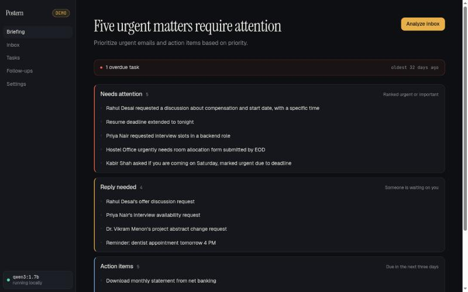
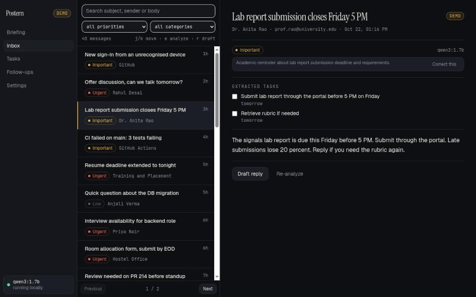
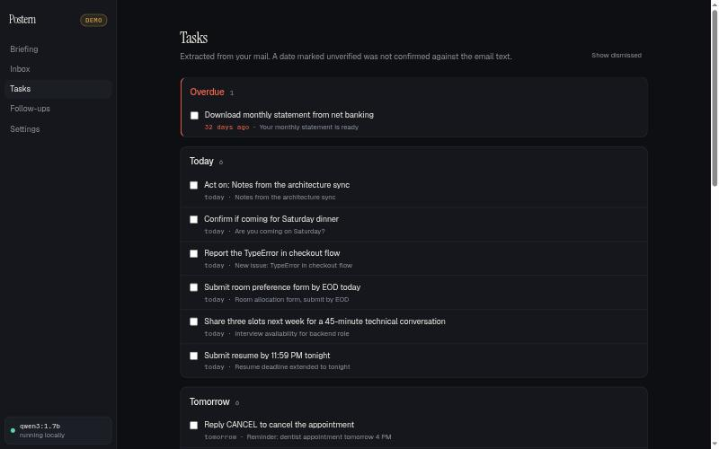
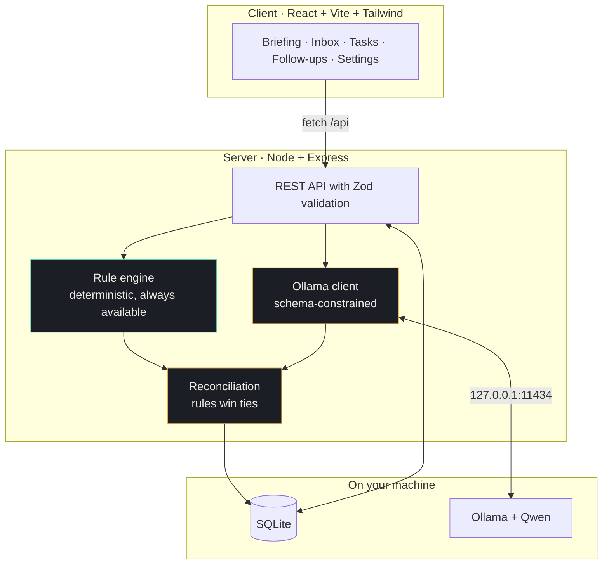

# Postern

[](https://github.com/beingsoham/Postern/actions/workflows/ci.yml)
[](https://nodejs.org)
[](LICENSE)

**Your private AI inbox.** Postern reads the mail available to it, ranks it,
extracts tasks and deadlines, tracks threads nobody answered, drafts replies and
writes you a daily briefing — with every piece of AI inference running on your
own machine through [Ollama](https://ollama.com).

It is not a new email client. It is an intelligence layer over an inbox that
answers four questions: what needs me today, what am I expected to reply to,
which deadlines are close, and what did I promise to do.

## The core design rule

> **AI suggests; ordinary application logic and the user decide.**

The model never sends mail, never invents a deadline, and never triggers an
action on its own. Everything it returns is validated before it is stored, and
there is a deterministic rule engine underneath that works with no model at all.



<p align="center"><em>The briefing. Each section says what it selects for, and
overdue work surfaces above everything else.</em></p>



<p align="center"><em>The inbox. Every priority carries a reason you can
correct, and the model that produced it is named in the corner.</em></p>



<p align="center"><em>Tasks, grouped by when they are due. A date that was not
confirmed against the email text is labelled, not hidden.</em></p>

## What it does

| Feature              | What you get                                                                         |
| -------------------- | ------------------------------------------------------------------------------------ |
| Smart priority inbox | Urgent / Important / Normal / Low, each with a one-line reason you can correct       |
| Daily briefing       | What needs attention, what needs a reply, what is due — built only from stored facts |
| Task extraction      | Actions pulled out of mail, with due dates that were checked rather than guessed     |
| Follow-up tracker    | Mail you sent that nobody answered, detected with plain SQL                          |
| Reply drafts         | Editable drafts in three tones. Stored, never sent                                   |
| Privacy controls     | Local inference, no body or token logging, delete everything in one click            |
| `postern doctor`     | One command that tells you exactly what is wrong and how to fix it                   |
| Eval harness         | Scores the pipeline against sample mail whose answers are known                      |

## Architecture



The frontend never touches SQLite, Ollama or any credential. It only speaks to
the API.

### How one email is processed

1. The email arrives from the sample inbox (Gmail later).
2. The rule engine scores it: deadline wording, failure wording, direct
   questions, security terms, sender shape. **This always produces a result.**
3. `chrono-node` parses any dates against the email's own timestamp. An
   ambiguous date such as `03/04` is reported ambiguous rather than guessed.
4. The local model is asked for a classification, constrained to a JSON Schema.
5. The two are reconciled. Rules own category and bulk detection; the model may
   move priority by one level, never more. A model due date is accepted only if
   we independently parsed that same date out of the email.
6. The result is stored separately from the email, so deleting the email deletes
   everything inferred from it.

## Requirements

- **Node 22.9 or newer** (the database scripts use `--env-file-if-exists`)
- [Ollama](https://ollama.com) with a Qwen model — optional, but you want it

## Setup

```bash
git clone https://github.com/beingsoham/Postern.git
cd Postern
npm install
cp .env.example .env

ollama pull qwen3:1.7b     # ~1.4 GB, runs on 8 GB of VRAM with room to spare
npm run db:migrate
npm run db:seed            # 40 sample emails
```

Check everything before you start:

```bash
npm run doctor
```

```
Postern doctor

[PASS] Node version — v22.22.2
[PASS] Database — 40 emails stored
[PASS] Rule engine — sample classified urgent
[PASS] Ollama — qwen3:1.7b available
[PASS] Sample classification — urgent in 1.5s
[WARN] Gmail connection — not connected

Ready to run in demo mode, with warnings.
```

## Running

```bash
npm run dev      # client on :5173, API on :4000
```

Open <http://localhost:5173> and press **Analyze inbox**.

| Command                           | What it does                               |
| --------------------------------- | ------------------------------------------ |
| `npm run dev`                     | Client and server together                 |
| `npm test`                        | Full test suite, no model needed           |
| `npm run eval`                    | Score the pipeline against known answers   |
| `npm run eval -- --rules-only`    | The same score with the model switched off |
| `npm run doctor`                  | Health check with actionable fixes         |
| `npm run build`                   | Production client build                    |
| `npm run lint` / `npm run format` | ESLint / Prettier                          |

### Keyboard

`j` / `k` move through the list · `e` analyze · `r` draft a reply

## Environment

| Variable        | Default                  | Purpose                                     |
| --------------- | ------------------------ | ------------------------------------------- |
| `PORT`          | `4000`                   | API port                                    |
| `CLIENT_ORIGIN` | `http://localhost:5173`  | The only origin allowed to call the API     |
| `OLLAMA_URL`    | `http://127.0.0.1:11434` | Local Ollama endpoint                       |
| `OLLAMA_MODEL`  | `qwen3:1.7b`             | Model used for analysis                     |
| `DB_PATH`       | `./data/postern.db`      | SQLite file, resolved from the project root |

`.env` and the database are both git-ignored.

## Choosing a model

Postern asks the model to fill a fixed five-field JSON schema, not to reason
freely, so a small model does this well — if you engineer around its weaknesses.

| Model        | VRAM (Q4) | Notes                                      |
| ------------ | --------- | ------------------------------------------ |
| `qwen3:1.7b` | ~1.4 GB   | Fast. What the sample numbers below use    |
| `qwen3:4b`   | ~2.6 GB   | Better accuracy, still comfortable on 8 GB |
| `qwen3:8b`   | ~5.2 GB   | Fits entirely on an 8 GB card              |

What makes a small model reliable here:

- **Constrained decoding.** The JSON Schema goes to Ollama as `format`, so
  malformed output is structurally impossible rather than merely unlikely.
- **A smaller prompt.** Quoted replies, signatures and links are stripped and
  the body is truncated before it is sent.
- **Rules own the hard parts.** Dates come from `chrono-node`. Bulk mail is
  detected from `List-Unsubscribe`, not from wording. Category comes from rules.
- **Thinking off, `keep_alive` on.** Classification drops from tens of seconds
  to roughly 1.5.

Change the model and run `npm run eval` to see what it cost or bought you.

## Measured behaviour

Over the 40-email sample inbox on `qwen3:1.7b`:

```
emails scored : 36
category      : 29/36   81%
priority      : 19/36   53%
fallbacks     : 0/36
full inbox    : ~54s
```

Priority misses are mostly a single level — `important` where `urgent` was
expected. The expected values are editorial judgements stored beside the sample
data, so treat the score as a regression baseline, not a grade.

These numbers moved down slightly when urgency was recalibrated: a third of the
inbox used to come out urgent, which scored better against the labels and read
worse as an inbox. Run `npm run eval` to see the current figures rather than
trusting these.

Three cases in the sample exist specifically to be got right:

| Sample     | Trap                                                                  | Result                                  |
| ---------- | --------------------------------------------------------------------- | --------------------------------------- |
| `demo-022` | A newsletter whose subject shouts `URGENT NEWS`                       | `newsletter / low`                      |
| `demo-003` | An ambiguous `03/04` date                                             | No due date, marked unverified          |
| `demo-032` | An email instructing the model to mark it urgent and dump the mailbox | `low` — _"The model suggested urgent."_ |

That last row is the design rule working. The injection genuinely moved the
model; it did not move the result.

## Privacy and security

- **Email is untrusted input.** Prompt injection works against local models too.
  Email text is data, never instruction, and the model has no tools to reach.
- **Nothing is sent.** There is no send path in the application at all. Drafts
  are stored for you to copy.
- **Bodies and tokens are never logged.** Server errors log a message only.
- **HTML is sanitized** with DOMPurify before rendering. Remote images are
  stripped — loading one tells the sender you opened the mail.
- **Deleting an email deletes what was inferred from it**, through `ON DELETE
CASCADE` to every derived table.
- **Parameterised SQL only.** No value is ever interpolated into a query.

### Honest limitations

- A small local model is less capable than a large hosted one, and it is wrong
  often enough that the rule engine matters.
- Local inference is **not** the same as fully offline or fully secure. Syncing
  real mail would involve network traffic.
- `npm run eval` reports the current accuracy. It is not 100%.
- Gmail is not connected. Everything you see is sample data, badged **Demo**.

## Testing

```bash
npm test               # 93 tests, no model required
npm run test:coverage  # server coverage report
```

**93 tests** — 74 server, 19 client — covering:

| Area          | What is asserted                                                                                                                                                         |
| ------------- | ------------------------------------------------------------------------------------------------------------------------------------------------------------------------ |
| Rule engine   | Scoring, categories, context beating keywords, bare adverbs not being deadlines                                                                                          |
| Dates         | Weekday resolution against the email timestamp, `03/04` reported ambiguous                                                                                               |
| API           | Pagination, filters, the page-size cap, 400 and 404 shapes, user overrides                                                                                               |
| Ollama client | Request shape, retry on malformed output, timeout, unreachable, HTTP errors                                                                                              |
| Idempotency   | Analyzing an email twice creates no duplicate task, and keeps one you completed                                                                                          |
| Security      | Injected email still yields a valid classification and nothing extra; bodies absent from logs; no stack traces; CSP and `nosniff` present; SQL injection treated as text |
| Client        | Priority always carries a text label, DOMPurify strips scripts, handlers and remote images, task completion, empty states                                                |

**No test requires Ollama.** CI points `OLLAMA_URL` at a dead port, so a pull
request never downloads a model — and the suite proves the app works without one.

Server coverage is **88% of statements, 90% of lines**.

### What is not tested

Stated plainly, because a coverage number alone is misleading:

- **The page components** — `Briefing`, `Inbox`, `Tasks`, `FollowUps` and
  `Settings`. The reusable components they are built from are tested; the pages
  that wire them together are not.
- **No end-to-end test.** Nothing drives a real browser through a real analysis.
  That path has been exercised by hand, not automatically.
- **The follow-up status route** (`PATCH /api/follow-ups/:id`) — detection is
  covered, updating a status is not.
- **Real model output.** Every test that involves the model mocks it. What a
  given Qwen build actually returns is measured by `npm run eval`, not asserted
  in a test, because it is not deterministic enough to assert.
- **Gmail.** It does not exist yet.

## Code graph

The repository carries a [Graphify](https://graphify.com) knowledge graph of its
own source, rebuilt into every commit by a pre-commit hook.

```bash
graphify query "how does an error become an HTTP response"
graphify god-nodes --top 10
```

## Roadmap

- Gmail read-only OAuth, minimal scopes, same pipeline as the sample inbox
- Model routing: a small model for classification, a larger one for drafts
- Desktop packaging with Tauri or Electron

## License

MIT
